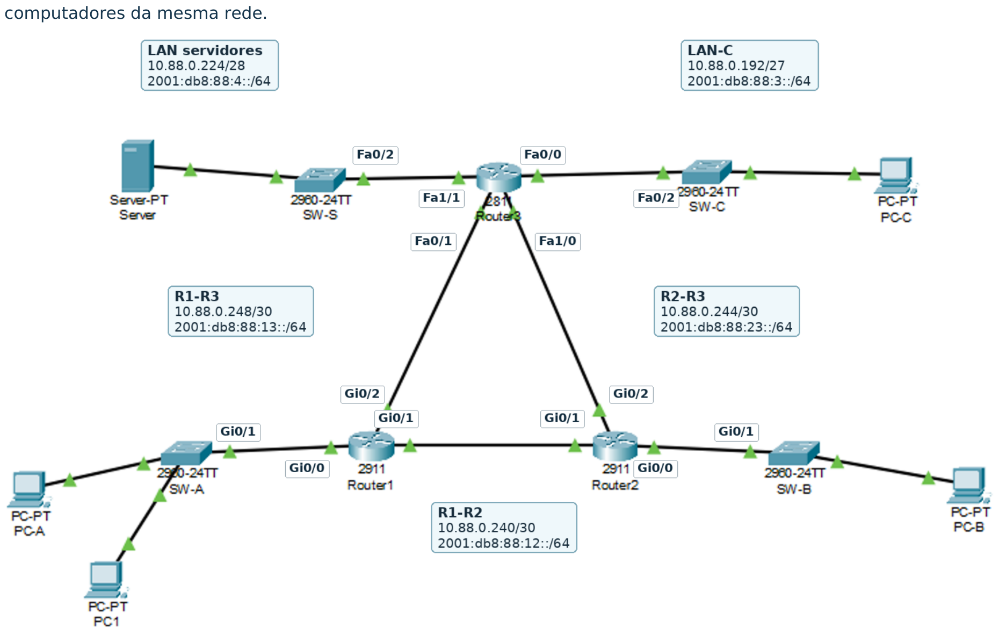
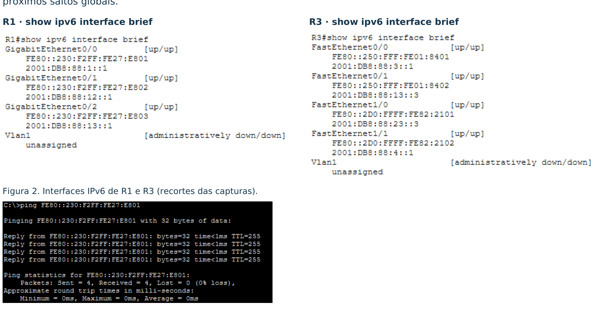
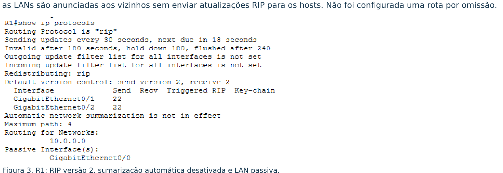
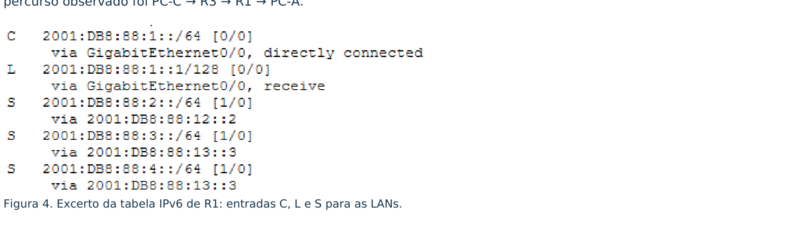
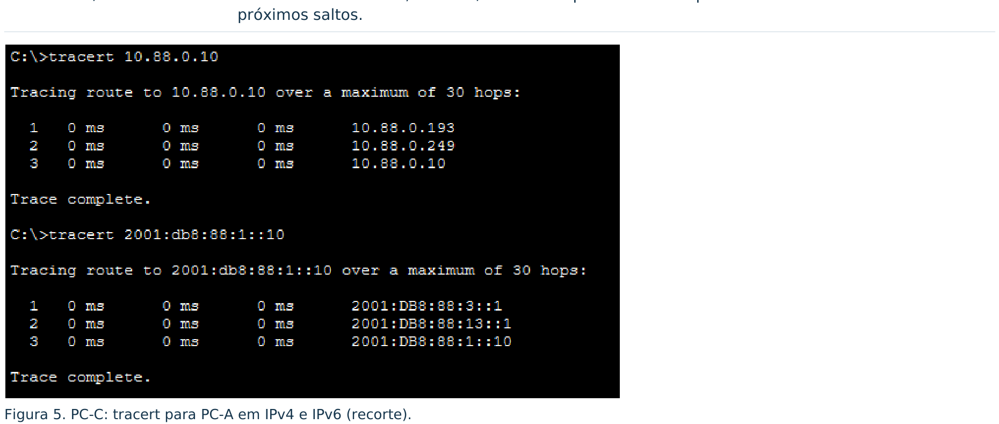
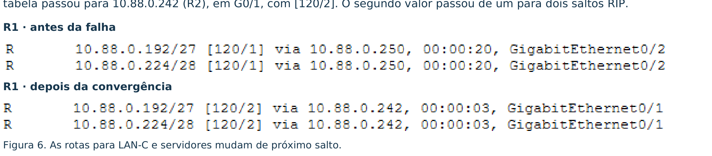
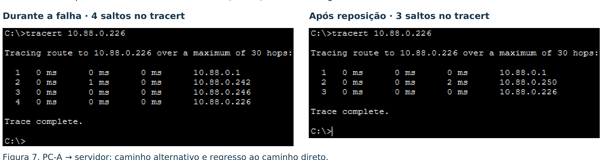

# Rede IPv4/IPv6 | Grupo 88
**Mini-Projeto 1 · Licenciatura em Engenharia Informática · ESTG / Politécnico de Leiria**  
**Unidade Curricular:** Redes de Computadores · 2026/2027 · Turma PL5  
**Autor:** Paulo Samuel Santos Gomes · N.º 22407711 · PL5 · Grupo 88  

---

## 📥 Ficheiros de Entrega para Avaliação

| Ficheiro | Descrição | Ligação Direta |
| :--- | :--- | :---: |
| **`Projeto_G88_IPv4.pkt`** | Topologia oficial configurada no Cisco Packet Tracer (v8.x) | [**Descarregar .PKT**](https://raw.githubusercontent.com/experimentos373-creator/Rede-IPv4-IPv6-Grupo88/main/Projeto_G88_IPv4.pkt) |
| **`Relatorio_Rede_IPv4_IPv6_Grupo88.pdf`** | Relatório técnico oficial de 5 páginas submetido | [**Ver / Descarregar PDF**](https://github.com/experimentos373-creator/Rede-IPv4-IPv6-Grupo88/blob/main/Relatorio_Rede_IPv4_IPv6_Grupo88.pdf) |

---

## 1. Topologia e Solução Implementada

A rede liga três instalações através dos routers **R1**, **R2** e **R3**, ligados em triângulo. Cada router liga uma LAN e o **R3** liga também a rede de servidores. O **PC1** foi acrescentado à **LAN-A** para testar a comunicação entre dois computadores da mesma rede.



*Figura 1. Topologia anotada: redes IPv4/IPv6 e interfaces das ligações entre routers e switches.*

### Equipamentos e Ligações
* **Routers:** R1 e R2 (Cisco 2911); R3 (Cisco 2811 com módulo de expansão **NM-2FE2W**).
* **Switches:** Quatro switches Cisco Catalyst 2960-24TT (`SW-A`, `SW-B`, `SW-C`, `SW-S`).
* **Terminais:** Quatro PCs (`PC-A`, `PC1`, `PC-B` e `PC-C`) e um servidor de rede (`Server-PT`).
* **Convenção de Interfaces:** `G` = GigabitEthernet; `F` = FastEthernet.

| Ligação | Extremo 1 | Extremo 2 |
| :--- | :--- | :--- |
| **LAN-A / LAN-B** | R1 `G0/0` → `SW-A` | R2 `G0/0` → `SW-B` |
| **LAN-C / Servidores** | R3 `F0/0` → `SW-C` | R3 `F1/1` → `SW-S` |
| **R1 - R2** | R1 `G0/1` | R2 `G0/1` |
| **R1 - R3** | R1 `G0/2` | R3 `F0/1` |
| **R2 - R3** | R2 `G0/2` | R3 `F1/0` |

**Funcionamento Geral:** O **VLSM** (*Variable Length Subnet Masking*) permite dimensionar as sub-redes IPv4. O protocolo de encaminhamento dinâmico **RIPv2** aprende os caminhos remotos e pode escolher um percurso alternativo em caso de falha de ligação. Em IPv6, cada segmento utiliza prefixo `/64` e o encaminhamento é estático com rotas justificadas por destino.

---

## 2. Dimensionamento das Sub-redes (Plano IPv4)

* **Bloco de trabalho atribuído:** `10.88.0.0/24` (VLSM por ordem decrescente de dimensão).
* Para cada segmento escolheu-se a menor sub-rede que satisfaz a necessidade: 126, 62, 30 e 14 endereços utilizáveis nas quatro LANs; dois em cada ligação `/30`. As sete sub-redes não se sobrepõem.

| Segmento / hosts | Rede / prefixo | Máscara | 1.º - último host | Broadcast |
| :--- | :--- | :--- | :--- | :--- |
| **LAN-A / 120** | `10.88.0.0/25` | `255.255.255.128` | `.1` - `.126` | `.127` |
| **LAN-B / 60** | `10.88.0.128/26` | `255.255.255.192` | `.129` - `.190` | `.191` |
| **LAN-C / 28** | `10.88.0.192/27` | `255.255.255.224` | `.193` - `.222` | `.223` |
| **Servidores / 12** | `10.88.0.224/28` | `255.255.255.240` | `.225` - `.238` | `.239` |
| **R1-R2 / 2** | `10.88.0.240/30` | `255.255.255.252` | `.241` - `.242` | `.243` |
| **R2-R3 / 2** | `10.88.0.244/30` | `255.255.255.252` | `.245` - `.246` | `.247` |
| **R1-R3 / 2** | `10.88.0.248/30` | `255.255.255.252` | `.249` - `.250` | `.251` |

> *Nota:* Os sufixos `.x` representam `10.88.0.x`. Foram reservados 252 dos 256 endereços do `/24`; o bloco `10.88.0.252/30` permanece livre.  
> *Exemplo de cálculo:* A LAN-A exige 120 hosts; $2^7 - 2 = 126$, logo usa-se `/25`.

---

## 3. Interfaces e Hosts IPv4

| Equipamento | Interface / segmento | IPv4 / prefixo | Gateway IPv4 |
| :--- | :--- | :--- | :---: |
| **R1** | `G0/0` · LAN-A | `10.88.0.1/25` | — |
| **R1** | `G0/1` · R2 | `10.88.0.241/30` | — |
| **R1** | `G0/2` · R3 | `10.88.0.249/30` | — |
| **R2** | `G0/0` · LAN-B | `10.88.0.129/26` | — |
| **R2** | `G0/1` · R1 | `10.88.0.242/30` | — |
| **R2** | `G0/2` · R3 | `10.88.0.245/30` | — |
| **R3** | `F0/0` · LAN-C | `10.88.0.193/27` | — |
| **R3** | `F0/1` · R1 | `10.88.0.250/30` | — |
| **R3** | `F1/0` · R2 | `10.88.0.246/30` | — |
| **R3** | `F1/1` · servidores | `10.88.0.225/28` | — |
| **PC-A** | `FastEthernet0` · LAN-A | `10.88.0.10/25` | `10.88.0.1` |
| **PC1** | `FastEthernet0` · LAN-A | `10.88.0.11/25` | `10.88.0.1` |
| **PC-B** | `FastEthernet0` · LAN-B | `10.88.0.130/26` | `10.88.0.129` |
| **PC-C** | `FastEthernet0` · LAN-C | `10.88.0.194/27` | `10.88.0.193` |
| **Servidor** | `FastEthernet0` · servidores | `10.88.0.226/28` | `10.88.0.225` |

**Configuração Base dos Routers:**
Os routers usam `hostname`, endereçamento IPv4/IPv6 e interfaces ativas (`no shutdown`). Foram configurados `enable secret`, autenticação na consola (`line con 0` + `login`), `service password-encryption` e `banner motd` de acesso restrito. A gravação com `copy running-config startup-config` devolveu `[OK]` nos três routers.

---

## 4. Plano IPv6 e Endereços Locais

* Foi usado o bloco **`2001:db8:88::/48`**, em que `88` identifica o grupo. O quarto bloco distingue as redes: `1` a `4` identificam as LANs e `12`, `23` e `13` identificam as ligações ponto-a-ponto entre routers. Foi atribuído um `/64` a cada segmento.
* *Nota metodológica:* A indicação inicial referia `2001:db8:88::/64`. Como um único `/64` não contém sete sub-redes independentes, adotou-se o bloco `/48`.

### Prefixos e Interfaces IPv6

| Segmento | Prefixo IPv6 | Interfaces / sufixos dos routers |
| :--- | :--- | :--- |
| **LAN-A** | `2001:db8:88:1::/64` | R1 `G0/0` → `::1` |
| **LAN-B** | `2001:db8:88:2::/64` | R2 `G0/0` → `::1` |
| **LAN-C** | `2001:db8:88:3::/64` | R3 `F0/0` → `::1` |
| **Servidores** | `2001:db8:88:4::/64` | R3 `F1/1` → `::1` |
| **R1-R2** | `2001:db8:88:12::/64` | R1 `G0/1` → `::1`; R2 `G0/1` → `::2` |
| **R2-R3** | `2001:db8:88:23::/64` | R2 `G0/2` → `::2`; R3 `F1/0` → `::3` |
| **R1-R3** | `2001:db8:88:13::/64` | R1 `G0/2` → `::1`; R3 `F0/1` → `::3` |

> *Regra de formação:* Cada sufixo completa o prefixo da linha: em R1-R3, R3 usa `2001:db8:88:13::3/64`. Os IDs são blocos hexadecimais.

### Configuração dos Hosts IPv6

| Host | Endereço IPv6 /64 | Gateway IPv6 |
| :--- | :--- | :--- |
| **PC-A** | `2001:db8:88:1::10` | `2001:db8:88:1::1` |
| **PC1** | `2001:db8:88:1::11` | `2001:db8:88:1::1` |
| **PC-B** | `2001:db8:88:2::10` | `2001:db8:88:2::1` |
| **PC-C** | `2001:db8:88:3::10` | `2001:db8:88:3::1` |
| **Servidor** | `2001:db8:88:4::10` | `2001:db8:88:4::1` |

### Interfaces e Utilização de Link-Local
As capturas mostram endereços globais e link-local automáticos, com as interfaces físicas `up/up`. O `PC-A` alcançou `FE80::230:F2FF:FE27:E801`, link-local de R1 na LAN-A: 4/4 respostas. Este teste é estritamente local à ligação; as rotas entre redes utilizam próximos saltos globais.



*Figura 2. Interfaces IPv6 de R1 e R3 (recortes das capturas de `show ipv6 interface brief` e ping).*

---

## 5. RIPv2: Anúncios e Escolha de Caminhos

Foi configurado `router rip`, `version 2`, `network 10.0.0.0` e `no auto-summary`.
São declaradas passivas as interfaces `G0/0` de R1 e R2 e `F0/0` e `F1/1` de R3 (`passive-interface`): as LANs são anunciadas aos vizinhos sem enviar atualizações periódicas de RIP para os computadores dos utilizadores. Não foi configurada uma rota por omissão.



*Figura 3. R1: RIP versão 2, sumarização automática desativada e LAN passiva (`show ip protocols`).*

---

## 6. Rotas Estáticas IPv6

O comando global `ipv6 unicast-routing` ativa o encaminhamento IPv6 nos três routers. Na tabela de rotas, `C` identifica redes diretamente ligadas, `L` identifica endereços locais e `S` identifica rotas estáticas. Para chegar às redes remotas, cada router envia os pacotes para o endereço global do router vizinho adjacente.

| Router | Destino /64 | Próximo salto / saída | Justificação |
| :---: | :--- | :--- | :--- |
| **R1** | `:2::` (LAN-B) | `:12::2` / G0/1 | LAN-B ligada diretamente ao R2 |
| **R1** | `:3::` e `:4::` | `:13::3` / G0/2 | Duas LANs (LAN-C e Servidores) ligadas ao R3 |
| **R1** | `:23::` (R2-R3) | `:12::2` / G0/1 | Ligação remota via R2 |
| **R2** | `:1::` (LAN-A) | `:12::1` / G0/1 | LAN-A ligada diretamente ao R1 |
| **R2** | `:3::` e `:4::` | `:23::3` / G0/2 | Duas LANs ligadas ao R3 |
| **R2** | `:13::` (R1-R3) | `:12::1` / G0/1 | Ligação remota via R1 |
| **R3** | `:1::` (LAN-A) | `:13::1` / F0/1 | LAN-A ligada ao R1 |
| **R3** | `:2::` (LAN-B) | `:23::2` / F1/0 | LAN-B ligada ao R2 |
| **R3** | `:12::` (R1-R2) | `:13::1` / F0/1 | Ligação remota via R1 |

*Prefixo comum:* `2001:db8:88:`. As linhas `:3::` e `:4::` representam duas rotas separadas no comando Cisco IOS. A saída indicada é resolvida através do próximo salto global; não foi escrita explicitamente no comando.

**Exemplo de comando em R1:**
```ios
ipv6 route 2001:db8:88:23::/64 2001:db8:88:12::2
```
A rede R2-R3 é alcançada via R2. Os testes `R1 → :23::3`, `R2 → :13::3` e `R3 → :12::2` responderam a 5/5 pedidos. Para a comunicação `PC-C → PC-A`, o percurso observado foi `PC-C → R3 → R1 → PC-A`.



*Figura 4. Excerto da tabela de encaminhamento IPv6 de R1 (`show ipv6 route`): entradas C, L e S.*

---

## 7. Validação da Conectividade

| Teste Realizado | Resultado Observado |
| :--- | :--- |
| **Mesma LAN / Gateway** | `PC1 → PC-A` e gateways locais: respostas 100% com sucesso em IPv4 e IPv6. |
| **LANs e Servidor** | `PC-C → PC-A`, `PC-B` e `Servidor`: pings IPv4/IPv6 concluídos; `PC-A` também alcançou todas as LANs remotas. |
| **Percursos / Tabelas** | `PC-C → PC-A`: percurso verificado `R3 → R1`, em IPv4 e IPv6. Comandos `show ip route` e `show ipv6 route` confirmaram destinos e próximos saltos corretos. |



*Figura 5. PC-C: comando `tracert` para PC-A em IPv4 (`10.88.0.10`) e IPv6 (`2001:db8:88:1::10`).*

---

## 8. Falha, Convergência e Reposição de uma Ligação

1. **Estado Inicial (Antes da falha):**  
   R1 alcançava a rede de servidores `10.88.0.224/28` diretamente através de `10.88.0.250` (R3), via interface `GigabitEthernet0/2`, com distância administrativa e métrica `[120/1]`.
2. **Simulação da Falha:**  
   Aplicou-se o comando `shutdown` na interface `G0/2` de R1. Após o período de convergência do RIPv2, a tabela de encaminhamento comutou para `10.88.0.242` (R2), via `GigabitEthernet0/1`, com métrica `[120/2]` (o custo passou de um para dois saltos RIP).



*Figura 6. Tabela de R1 antes da falha (`[120/1]` via R3) e após convergência (`[120/2]` via R2).*

3. **Validação do Percurso Alternativo:**  
   O comando `tracert` a partir de `PC-A` (`10.88.0.10`) em direção ao `Servidor` (`10.88.0.226`) confirmou o salto através de 4 nós: `PC-A → R1 → R2 → R3 → Servidor`.
4. **Reposição da Ligação:**  
   Foi aplicado `no shutdown` na interface `G0/2` de R1. A tabela de rotas restabeleceu o próximo salto direto `.250` (`[120/1]`) e o teste de `tracert` regressou ao caminho direto de 3 saltos (`R1 → R3 → Servidor`).



*Figura 7. `tracert` de PC-A para o Servidor: 4 saltos durante a falha e regresso a 3 saltos após reposição.*

### Conclusão do Relatório
Os testes demonstraram comunicação plena fim-a-fim em IPv4 e IPv6. Ao desligar a ligação R1-R3, o protocolo dinâmico RIPv2 comutou automaticamente para o caminho redundante através de R2 e restabeleceu o caminho direto após a reposição física do link. O percurso inicial e alternativo foi validado pelas tabelas de routing e evidenciado pelos comandos `tracert`.

---

## 💻 Instruções para Abrir no Cisco Packet Tracer

1. Transfere o ficheiro [`Projeto_G88_IPv4.pkt`](https://raw.githubusercontent.com/experimentos373-creator/Rede-IPv4-IPv6-Grupo88/main/Projeto_G88_IPv4.pkt).
2. Abre a aplicação **Cisco Packet Tracer** (versão 8.0 ou superior).
3. Clica em **File** $\rightarrow$ **Open...** e escolhe o ficheiro `Projeto_G88_IPv4.pkt`.
4. Nos PCs de teste (`PC-A`, `PC-C`), abre o **Desktop** $\rightarrow$ **Command Prompt** para validar os testes:
   ```cmd
   ping 10.88.0.226
   tracert 10.88.0.226
   ping 2001:db8:88:4::10
   ```
