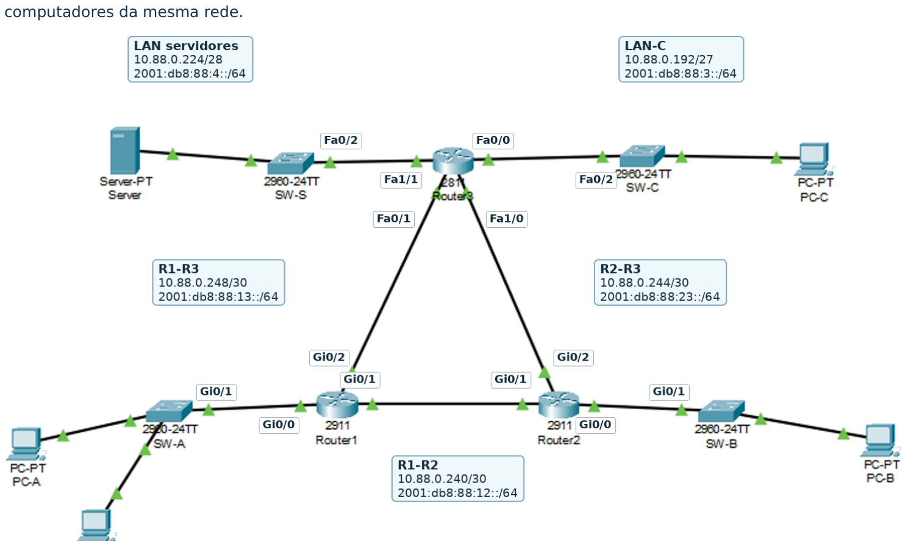

# Rede IPv4/IPv6 — Mini-Projeto 1 (Grupo 88)

> **Unidade Curricular:** Redes de Computadores — 2026/2027  
> **Curso:** Licenciatura em Engenharia Informática  
> **Instituição:** Escola Superior de Tecnologia e Gestão (ESTG) — Instituto Politécnico de Leiria  
> **Turma:** PL5 | **Grupo:** 88  
> **Autor:** Paulo Samuel Santos Gomes (N.º 22407711)  

---

## 📥 Ficheiros do Projeto para Avaliação

| Ficheiro | Descrição | Download Direto |
| :--- | :--- | :---: |
| **`Projeto_G88_IPv4.pkt`** | Topologia oficial configurada e funcional no Cisco Packet Tracer | [**Descarregar .PKT**](https://raw.githubusercontent.com/experimentos373-creator/Rede-IPv4-IPv6-Grupo88/main/Projeto_G88_IPv4.pkt) |
| **`Relatorio_Rede_IPv4_IPv6_Grupo88.pdf`** | Relatório técnico de 5 páginas com evidências, tabelas e testes | [**Ver / Descarregar PDF**](https://github.com/experimentos373-creator/Rede-IPv4-IPv6-Grupo88/blob/main/Relatorio_Rede_IPv4_IPv6_Grupo88.pdf) |

---

## 1. Topologia da Rede

A infraestrutura interliga três instalações através de três routers (**R1**, **R2** e **R3**) configurados em malha triangular redundante. Cada router suporta uma rede local (LAN) e o router **R3** interliga adicionalmente a zona de servidores. O **PC1** foi integrado na **LAN-A** para validar a comunicação entre computadores no mesmo segmento de rede.



### Equipamentos e Módulos:
* **R1 e R2:** Cisco 2911 (interfaces GigabitEthernet `G0/0`, `G0/1`, `G0/2`).
* **R3:** Cisco 2811 com módulo de expansão **NM-2FE2W** (interfaces FastEthernet `F0/0`, `F0/1`, `F1/0`, `F1/1`).
* **Switches:** 4x Cisco Catalyst 2960-24TT (`SW-A`, `SW-B`, `SW-C`, `SW-S`).
* **Terminais:** 4 PCs (`PC-A`, `PC1`, `PC-B`, `PC-C`) e 1 Servidor corporativo.

---

## 2. Plano de Endereçamento IPv4 (VLSM)

* **Bloco Atribuído:** `10.88.0.0/24`
* Dimensionamento por **VLSM** (*Variable Length Subnet Masking*) ordenado por ordem decrescente de necessidade de hosts para aproveitamento ótimo sem sobreposição.

| Segmento | Hosts Nec. | Rede / Prefixo | Máscara | 1.º Host Útil | Último Host Útil | Broadcast |
| :--- | :---: | :--- | :--- | :--- | :--- | :--- |
| **LAN-A** | 120 | `10.88.0.0/25` | `255.255.255.128` | `10.88.0.1` | `10.88.0.126` | `10.88.0.127` |
| **LAN-B** | 60 | `10.88.0.128/26` | `255.255.255.192` | `10.88.0.129` | `10.88.0.190` | `10.88.0.191` |
| **LAN-C** | 28 | `10.88.0.192/27` | `255.255.255.224` | `10.88.0.193` | `10.88.0.222` | `10.88.0.223` |
| **Servidores** | 12 | `10.88.0.224/28` | `255.255.255.240` | `10.88.0.225` | `10.88.0.238` | `10.88.0.239` |
| **R1 - R2** | 2 | `10.88.0.240/30` | `255.255.255.252` | `10.88.0.241` | `10.88.0.242` | `10.88.0.243` |
| **R2 - R3** | 2 | `10.88.0.244/30` | `255.255.255.252` | `10.88.0.245` | `10.88.0.246` | `10.88.0.247` |
| **R1 - R3** | 2 | `10.88.0.248/30` | `255.255.255.252` | `10.88.0.249` | `10.88.0.250` | `10.88.0.251` |

---

## 3. Plano de Endereçamento IPv6

* **Bloco Atribuído:** `2001:db8:88::/48` (cada segmento com prefixo `/64`).

| Segmento | Prefixo IPv6 /64 | Interfaces dos Routers |
| :--- | :--- | :--- |
| **LAN-A** | `2001:db8:88:1::/64` | R1 `G0/0` → `::1` |
| **LAN-B** | `2001:db8:88:2::/64` | R2 `G0/0` → `::1` |
| **LAN-C** | `2001:db8:88:3::/64` | R3 `F0/0` → `::1` |
| **Servidores** | `2001:db8:88:4::/64` | R3 `F1/1` → `::1` |
| **R1 - R2** | `2001:db8:88:12::/64` | R1 `G0/1` (`::1`), R2 `G0/1` (`::2`) |
| **R2 - R3** | `2001:db8:88:23::/64` | R2 `G0/2` (`::2`), R3 `F1/0` (`::3`) |
| **R1 - R3** | `2001:db8:88:13::/64` | R1 `G0/2` (`::1`), R3 `F0/1` (`::3`) |

---

## 4. Encaminhamento e Configurações

### IPv4 (RIPv2 Dinâmico):
* Ativado com `router rip`, `version 2`, `network 10.0.0.0` e `no auto-summary`.
* **Interfaces Passivas:** Configuradas como `passive-interface` nas interfaces voltadas para as LANs (`G0/0` em R1/R2, `F0/0` e `F1/1` em R3) para impedir a propagação desnecessária de pacotes de routing para os utilizadores finais.

### IPv6 (Encaminhamento Estático):
* Ativado com `ipv6 unicast-routing` nos 3 routers.
* Rotas estáticas configuradas com salto global explícito para garantir conectividade determinística ponto-a-ponto entre todas as redes.

---

## 5. Validação de Conectividade e Tolerância a Falhas

1. **Testes de Conectividade:**
   * Pings intra-LAN (`PC-A` $\leftrightarrow$ `PC1`) e inter-LAN (`PC-C` $\rightarrow$ `PC-A`, `PC-B`, `Servidor`) concluídos com 100% de sucesso em IPv4 e IPv6.
2. **Simulação de Falha e Convergência (Link R1-R3):**
   * Ao aplicar `shutdown` na interface `G0/2` de **R1**, o protocolo RIPv2 detetou a quebra e reencaminhou o tráfego de `PC-A` para o `Servidor` através de **R2** (aumentando a métrica de 1 para 2 saltos).
   * O `tracert` confirmou a rota alternativa `R1 → R2 → R3 → Servidor`.
   * Após `no shutdown`, a rede convergiu de volta para o caminho direto `R1 → R3` (1 salto), demonstrando a alta resiliência da arquitetura.

---

## 🚀 Como Abrir e Testar no Cisco Packet Tracer

1. Descarrega o ficheiro [`Projeto_G88_IPv4.pkt`](https://raw.githubusercontent.com/experimentos373-creator/Rede-IPv4-IPv6-Grupo88/main/Projeto_G88_IPv4.pkt).
2. Abre o **Cisco Packet Tracer** (v8.0 ou superior).
3. Vai a **File** $\rightarrow$ **Open...** e seleciona o ficheiro `.pkt`.
4. Abre o Command Prompt de qualquer PC (ex: `PC-A` ou `PC-C`) e testa a conectividade:
   ```cmd
   ping 10.88.0.226
   tracert 10.88.0.226
   ping 2001:db8:88:4::10
   ```
